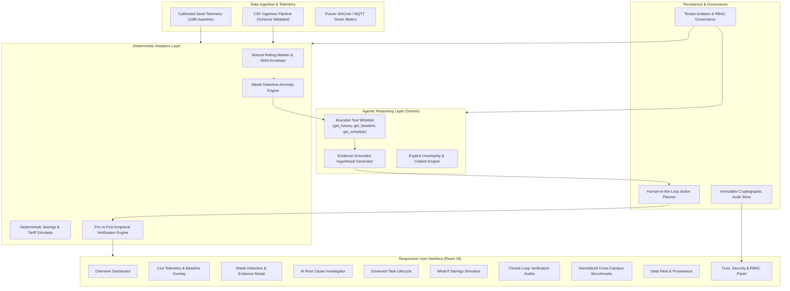

# Technical Architecture — EcoPilot AI

EcoPilot AI is built on a modular, decoupled full-stack architecture designed for educational institutions.

---

## 1. Complete Architecture Diagram

---

## 2. Core Operational Loop Specifications

1. **MONITOR:** Ingests 15-minute resolution electricity (kWh) and water (Litres) telemetry. Tags timestamps with building operating schedules (`isOccupiedPeriod: boolean`).
2. **DETECT:** Evaluates consumption against historical rolling median baselines:
   - Unoccupied schedule consumption (e.g. HVAC/lighting running overnight).
   - Nocturnal water baseflow (leaks never returning to zero between 02:00 and 05:00).
   - Sudden surge (readings exceeding median + 2.5 MAD).
3. **INVESTIGATE:** Gemini agent executes bounded retrieval tools (`get_resource_history`, `get_baseline`, `get_occupancy_schedule`, `calculate_resource_deviation`) to formulate ranked physical hypotheses with cited evidence.
4. **PRIORITIZE:** Action Planner queues tasks in `Pending Approval` with calculated daily recoverable losses and priority ratings.
5. **ACT:** Human facility manager approves tasks and field technicians complete physical work orders with signed verification records.
6. **VERIFY:** Automated verification engine pulls post-intervention meter telemetry, compares against pre-intervention baseline, and calculates empirical reduction percentage. Refuses to conclude without at least 6 hours of real sensor data.
7. **SUSTAIN:** Aggregates verified avoided CO₂e emissions, financial budget recovery, and normalized cross-campus benchmarking indices.

