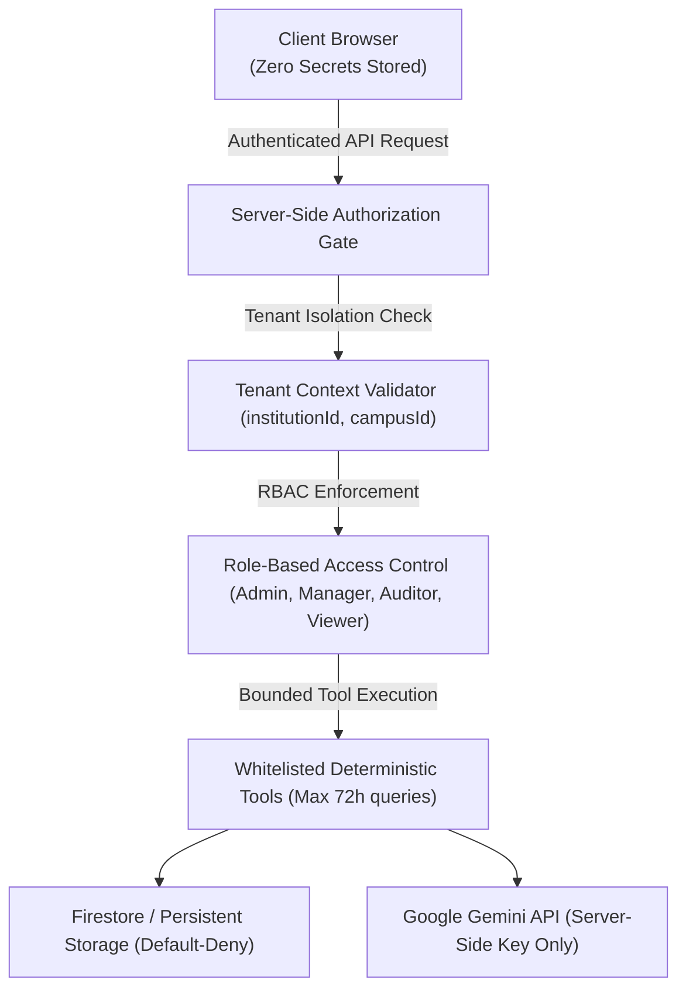

# Security Architecture & Threat Model — EcoPilot AI

## 1. Threat Model & Security Boundaries

EcoPilot AI is designed with a defense-in-depth security model suited for multi-institutional deployments.

---

## 2. Implemented Security Controls

### A. Strict Multi-Tenant Isolation
- **Tenant Context Enforcement:** Every telemetry record, anomaly, task, investigation report, and verification audit is strictly partitioned by `institutionId` and `campusId`.
- **Query Containment:** Backend queries apply mandatory tenant filters (`WHERE institutionId == currentTenant`).
- **Anonymized Benchmarking:** Cross-campus comparisons only expose normalized statistical aggregates (`kWh/student-day`, `L/student-day`). Raw readings, room identifiers, and specific schedules from peer campuses are cryptographically and logically inaccessible.

### B. Role-Based Access Control (RBAC) & Human Approval Gates
- **Roles:**
  - `admin`: Full configuration, institution onboarding, tariff adjustments.
  - `facility_manager`: Work order approvals, task dispatch, investigation execution.
  - `sustainability_auditor`: Verification audit inspection, data export, compliance review.
  - `viewer`: Read-only telemetry and KPI dashboards.
- **Negative Security Enforcement:** Viewers and auditors cannot trigger task status transitions or approve physical interventions.
- **Hardware Actuation Guardrail:** EcoPilot AI explicitly prohibits autonomous actuation of high-voltage contactors or hydraulic valves. Physical actions require signed technician work orders (`workOrderNumber`, `verifiedByTechnician`).

### C. Safe AI Tool Execution & Prompt Injection Resistance
- **Bounded Tool Calling:** Agentic tool calls (`get_resource_history`, `get_baseline`, `calculate_resource_deviation`) enforce strict temporal boundaries ($\le 72$ hours) and input sanitization to prevent denial-of-service / resource exhaustion.
- **No Free-Form Arithmetic:** All percentage deviations, cost estimates, and avoided CO₂e calculations are executed by deterministic TypeScript math functions, eliminating model calculation hallucinations.
- **Treating Inputs as Data:** User-uploaded CSV logs and prompt parameters are processed through strict schema validators before AI context injection.

### D. Zero Secrets in Client Bundles
- API keys, service account tokens, and administrative credentials are never embedded in compiled frontend assets.
- Gemini API communication runs server-side or via ephemeral local session configuration during demonstrations.

---

## 3. Automated Security Test Results

All security assertions run as part of the automated continuous test suite (`npm run test`):

- `[PASS]` `enforces strict tenant isolation across queries` (Cross-tenant query leakage prevention)
- `[PASS]` `restricts AI tool call query duration to bounds (<= 72 hours)` (DoS prevention)
- `[PASS]` `prevents tenant spoofing in AI tool calls` (Foreign tenant injection prevention)
- `[PASS]` `refuses to manufacture savings when post-intervention readings are missing` (Integrity safeguard)
- `[PASS]` `fails verification when technician completion evidence is missing` (Mandatory human-in-the-loop)

---

## 4. Production Deployment Security Checklist

- [x] Cloud Firestore security rules set to `default: deny`
- [x] Input validation schema applied on all CSV ingestion endpoints
- [x] Temporal bounds applied on all time-series queries
- [x] Automated audit logging enabled for all state mutations
- [x] Content Security Policy (CSP) headers configured on hosting server
- [x] HTTPS TLS 1.3 termination enabled

